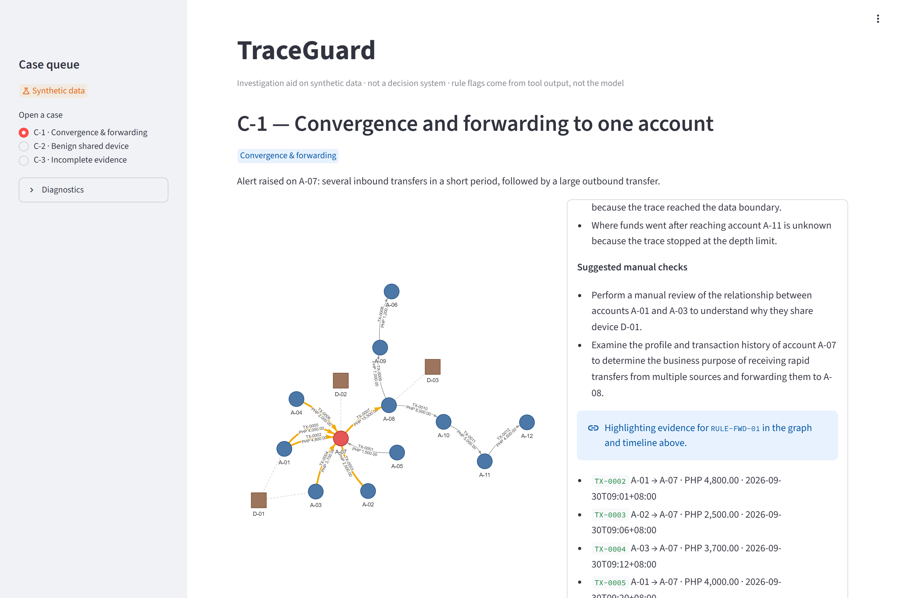
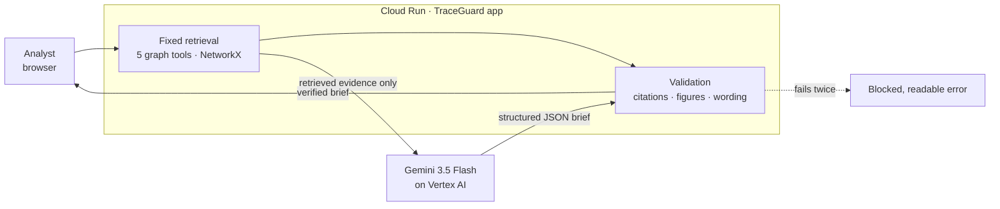

# TraceGuard

**Follow the connections. Keep the judgment human.**

TraceGuard is a graph-powered AI investigation assistant for fraud analysts at banks, e-wallets and fintechs.
It traces fund movements across accounts, devices and time, then uses Gemini on Vertex AI to write a case
brief in which every claim is cited to a real record. Every brief is validated before an analyst sees it.

[**Live app**](https://traceguard-343683630064.asia-southeast1.run.app) ·
[**Demo video (3:56)**](https://drive.google.com/file/d/15qQuek3NzyF3jAUqO0b61K3u1IBdCGOg/view) ·
[**Proposal deck**](submission/TraceGuard-proposal.pptx)

Built for the **AI Builder Cup 2026** (Google Cloud × Hack2skill), BFSI theme, by Team Chilli.
**All data is synthetic.**



## Why

A single alert rarely tells the whole story. The risk sits *between* the records: who paid whom, in what
order, and which accounts share a device. Analysts must reconstruct that by hand, then explain it in a case
file. A generic AI summary is not good enough here: it can invent a transaction, state a wrong total, or
call someone a fraudster.

TraceGuard splits the work so each part does what it is good at: **graph tools compute, Gemini explains,
the analyst judges.**

## What it does

- **Case queue:** three synthetic alerts, each showing a different situation. C-1 is a pattern that
  warrants review, C-2 is a shared device with an ordinary explanation, and C-3 is a trail that leaves the
  available data.
- **Relationship graph and timeline:** accounts, devices and one arrow per transfer, so repeated transfers
  never merge. Click a node to see its evidence; select timeline rows to highlight them on the graph.
- **AI investigation:** one click runs a fixed workflow of five deterministic graph tools (account context,
  fund trace, shared devices, rapid forwarding, fan-in). Gemini then drafts a brief with observations,
  counterevidence, unknowns and suggested checks.
- **Verified before display:** the app checks every cited ID against the retrieved evidence, matches every
  figure to tool output, and rejects accusatory or probability wording. If a brief fails, it is retried
  once, then blocked. The checks are shown beside the brief.
- **Clickable citations:** each evidence ID highlights its records on the graph and timeline.
- **Follow-up questions:** answered from the same evidence with the same checks. Questions the data can't
  answer, such as "Who owns A-22?", are declined, and the reply names the data that would be needed.
- **Export:** download the brief as Markdown for the case file.

## How it works



- **Deterministic evidence:** paths, time windows, sums, rule flags and contrasts come from code
  (`traceguard/graph/`), never from the model. Money trails must be time-ordered.
- **Grounded generation:** Gemini receives only the evidence bundle, capped at 60,000 characters, and
  returns a schema-checked JSON brief (`traceguard/ai/`). There are no free-form queries and no
  model-written code.
- **Validation as a gate:** `traceguard/ai/validate.py` rejects unknown IDs, figures not in the tool
  output, and forbidden wording. A failed brief is never displayed.

### Google Cloud services

| Service | Role |
|---|---|
| **Gemini 3.5 Flash on Vertex AI** | Writes the brief as structured JSON via the `google-genai` SDK, with LOW thinking: 3–9 s per brief, measured |
| **Cloud Run** | Hosts the public app in `asia-southeast1`; scales to zero, max 2 instances |
| **Cloud Build · Artifact Registry** | Builds and stores the container on each source deploy |
| **IAM · Application Default Credentials** | No API keys. The runtime service account has only `roles/aiplatform.user` |

## Responsible AI by design

The rules below are enforced in code and covered by tests (see [the PRD](docs/prd.md) for all of them):

- Synthetic data only: 35 accounts, 102 transfers, 22 device links and 3 cases, in PHP (BR-001).
- Every cited ID must exist in the retrieved evidence (BR-002).
- Numbers and rule flags come from code, not the model (BR-003).
- No accusations, probabilities or risk scores: "pattern warrants review", never "guilty" (BR-004).
- Unknowns are stated. Similar amounts are never called the same money (BR-005).
- Live and cached output are always labelled (BR-006).

TraceGuard is an investigation aid. It does not block transfers, decide guilt, file regulatory reports or
score customers.

## Run it locally

You need Python 3.12, the [Google Cloud CLI](https://cloud.google.com/sdk/docs/install), and a Google Cloud
project with the Vertex AI API enabled. The graph and timeline work without Gemini; only the AI
investigation needs it.

```bash
git clone https://github.com/shieryl-ryle/traceguard.git
cd traceguard
python -m venv .venv
# Windows: .venv\Scripts\Activate.ps1    macOS/Linux: source .venv/bin/activate
python -m pip install -r requirements.txt -r requirements-dev.txt

gcloud auth application-default login     # local Gemini calls run as you; no API keys
export GOOGLE_CLOUD_PROJECT=<your-project-id>
export VERTEX_LOCATION=asia-southeast1
export GEMINI_MODEL=gemini-3.5-flash
streamlit run app.py
```

On Windows PowerShell, set the variables with `$env:GOOGLE_CLOUD_PROJECT = "<your-project-id>"` and so on.
Deploying to Cloud Run, with the least-privilege IAM roles, is covered in
[docs/system-design.md §7](docs/system-design.md) and [docs/setup.md](docs/setup.md).

## Tests

```bash
python -m pytest -m "not live"     # 168 tests: fixtures, boundaries, errors, honesty rules
python -m mypy traceguard app.py   # strict typing
python -m pytest -m live           # optional: calls real Gemini on Vertex AI (uses quota)
```

## Repository layout

| Path | Contents |
|---|---|
| `app.py`, `traceguard/ui/` | Streamlit UI: queue, graph, timeline, brief, citations, export |
| `traceguard/graph/` | Dataset loader, the five graph tools, fixed retrieval |
| `traceguard/ai/` | Prompt, Gemini client, schema, validation, follow-up questions |
| `data/` | The synthetic dataset and its seeded generator |
| `tests/` | pytest suite and expected outcomes for each case |
| `docs/` | PRD, system design, QA plan, implementation plan, ADRs |
| `submission/` | Proposal deck and its build script, screenshots, demo video tooling |

## Built with coding assistant

The repo was set up for agent-assisted work. [AGENTS.md](AGENTS.md) routes an agent to the one doc that
owns each concern. `/start-task` claims a `TASK-###` on its own branch, and the `rules-reviewer` and
`test-runner` agents check changes against the business rules and test gates before merge.

## Team

**Team Chilli:** Shieryl Tendilla (team lead: UI, AI prompts, demo, deck) and Dzelle Faith Tan (graph backend,
dataset, deployment).

## License

The code and documentation are released under the [MIT License](LICENSE).

The proposal deck uses the organisers' AI Builder Cup template. Google, Google Cloud, Gemini, Vertex AI
and the AI Builder Cup and Hack2skill marks belong to their owners and are not covered by this license. The
demo video's logo marks come from [LobeHub Icons](https://github.com/lobehub/lobe-icons) (MIT) and
[Simple Icons](https://simpleicons.org) (CC0). The voice-over uses [Kokoro-82M](https://huggingface.co/hexgrad/Kokoro-82M)
(Apache-2.0).
